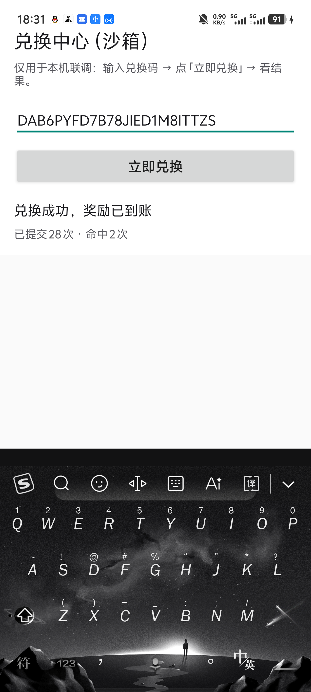
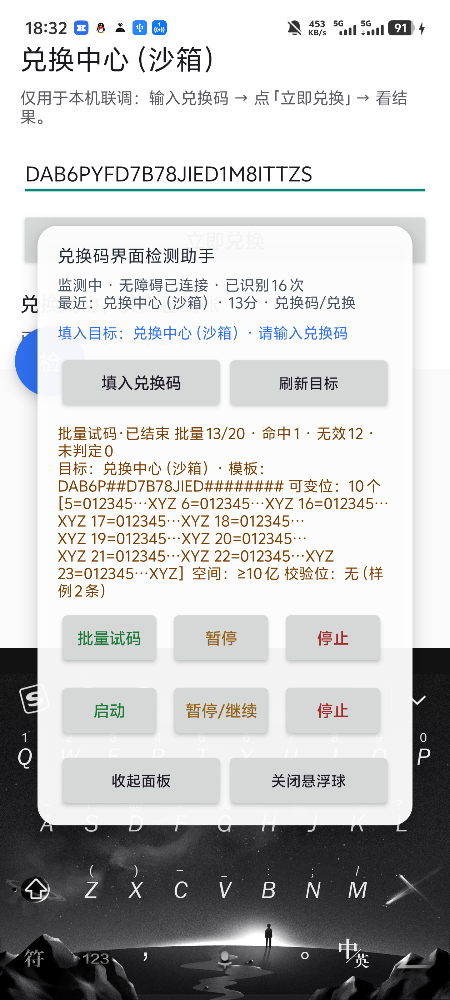

# 兑换码工具集 — couponfmt + CouponWatch

两个互相独立、又可以串成一个闭环的本地工具：**一个是 Python 的兑换码格式分析器，一个是 Android 的兑换弹窗检测与填码助手**。全部离线运行，不连任何兑换平台。

| | 是什么 | 技术栈 | 规模 |
|---|---|---|---|
| **couponfmt** | 命令行：样例 → 归纳格式规则 → 生成测试数据 → 校验/统计/导出 → 本地模拟页跑浏览器自动化 | Python 3.9+ | 29 个 .py / 约 4.1k 行 / **79 个 pytest** |
| **CouponWatch** | Android 应用：识别「疑似兑换弹窗」，手动单条填入，或批量试码自动提交、无效自动换下一条 | Kotlin + Compose + Room | 44 个 .kt / 约 6.4k 行 / **35 个 JVM 单测** |

真实跑起来的两个画面：

| 批量试码命中 | 悬浮球面板 |
|---|---|
|  |  |

> 截图来自自建沙箱目标 App（`android-app/mocktarget/`），判定规则 `code.sumOf { it.code } % 11 == 0`，用来验证"填入 → 提交 → 读结果 → 换下一条"整条链路，而不是拿真实平台当靶子。

---

## 一、couponfmt：从样例反推格式

```bash
python main.py analyze samples/codes.txt      # 归纳格式：模板、可变位、字符池、校验位
python main.py gen     samples/codes.txt -n 200 --validate   # 生成并自校验
python main.py validate samples/codes.txt     # 逐段定位不合规的码
python main.py report  samples/codes.txt --out out/report.md
python main.py rules   samples/codes.txt      # 导出规则 JSON
python main.py mock    samples/codes.txt      # 起本地模拟页
python main.py autotest samples/codes.txt     # Playwright 自动化（默认 dry-run）
```

设计要点：

- **不写死任何格式**。规则全部由样例归纳，换一批样例就换一套规则。
- **三条归纳路径**：定长逐位、变长分段、校验位探测（Luhn / Damm / Verhoeff / ISO 7064 / 加权和）。
- **生成受样例约束**。固定前后缀保护不变，只在可变位采样，可选强制重算校验位。

完整用法、Windows 运行教程、手机端方案、样例输出：**[couponfmt/README.md](couponfmt/README.md)**。

## 二、CouponWatch：在手机上识别并填码

五个页面：首页 / 日志 / 格式 / 过滤 / 自检。核心链路：

1. **识别**：无障碍服务收到窗口事件 → 扫描节点 → 打分（关键词命中最 9 分、可编辑框 +2、兑换按钮 +2、强词组 +2、有标题 +1）→ 达到阈值记为「疑似兑换弹窗」并落库。
2. **手动填入**：目标 App 里点开兑换框 → 点悬浮球 → 点「填入兑换码」，只写这一条、不点提交。
3. **批量试码**：给几条真实样例 → 按位归纳（可变位、字符类字母表、校验位、空间大小）→ 逐条写入前台 App、点提交、轮询结果 → 无效就清空换下一条，命中就留住完整码。
   - 判定两级：先看提交前后的**新增文本**，超时后用**整屏文本**兜底，但 `SUCCESS` 不接受兜底（避免把上一条的残留成功文案算进来）。
   - 节奏：默认 1200 ms 间隔、±35% 抖动；遇到限流词指数退避到 12 s，连续 3 次限流即停。
   - 结构性失败（找不到窗口/输入框/按钮、写入失败、目标 App 被切走）直接中止，不空转。

构建与安装：

```bash
cd android-app
gradle.bat --no-daemon --console=plain assembleLiteDebug assembleFullDebug testLiteDebugUnitTest
adb install -r app/build/outputs/apk/lite/debug/app-lite-debug.apk
```

`lite` 11.2 MB（无 OCR）/ `full` 56 MB（含 ML Kit 离线 OCR 模型）。装完还要手动开无障碍（系统限制，应用无法自行开启），详见 **[android-app/README.md](android-app/README.md)**。

## 三、仓库结构

```
.
├── main.py / couponfmt/          # Python CLI（analyze / gen / validate / report / rules / mock / autotest）
├── samples/  rules/  tests/      # 样例、规则、79 个 pytest
├── automation/                   # Playwright 脚本（仅本机模拟页）
├── android-app/
│   ├── app/src/main/java/...     # 检测引擎、无障碍服务、悬浮球、Room、Compose 五页
│   ├── app/src/main/java/com/couponwatch/detector/format/CodeEnumerator.kt      # 样例 → 候选码
│   ├── app/src/main/java/com/couponwatch/detector/service/BatchTrialRunner.kt   # 批量试码执行器
│   ├── app/src/main/java/com/couponwatch/detector/service/BatchVerdict.kt       # 结果判定
│   ├── app/src/test/...          # 35 个 JVM 单测
│   └── mocktarget/               # 沙箱目标 App（联调/演示用）
├── docs/                         # 安装指南、构建报告、限制说明
└── HANDOFF-2026-11-14.md         # 完整交接：设计、阈值、踩坑、真机验证记录
```

## 四、真机验证记录

vivo V2339A（Android 16 / API 36），对沙箱目标 App 跑 20 条候选：

```
start  -> 已开始：20 条候选 (samples=2)
state  -> 13/20 hits=1 misses=12 unknown=0
hits   -> DAB6PYFD7B78JIED1M8ITTZS
```

样例归纳出的模板：`DAB6P##D7B78JIED########`（24 位、固定 14 位、可变 10 位、36 进制、无校验位、空间 36¹⁰ ≈ 3.66×10¹⁵）。悬浮球面板同步显示进度与命中列表，`detection_logs` 里 `action=BATCH` 的行留了每条的判定结果。

> 空间量级决定策略：`space ≥ 200000` 时自动用随机采样，否则顺序推进——对着 3.66×10¹⁵ 的顺序枚举没有意义。

## 五、边界

- 格式匹配只代表"像"，**不代表兑换码有效**；couponfmt 全程不联网、不提交。
- 批量试码是在**你当前打开的目标 App** 上做真实点击的，请只对自己有权操作的 App 使用。
- 应用不读取密码框、不绕过 `FLAG_SECURE`、不注入手势、不需要 root。
- 权限清单里只有本地能力，没有 `INTERNET`。

## 六、许可

MIT，见 [LICENSE](LICENSE)。
